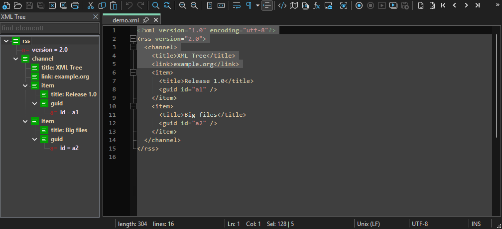

# XML Tree for Notepad++

A dockable tree panel for XML documents in Notepad++, built to **replicate the XML tree
workflow of FOXE** ([First Object's XML editor](https://www.firstobject.com/dn_editor.htm)):
the same tree on the left, the same habit of jumping around a big document, without
leaving the editor you already write in.

Elements and attributes in a tree on the left, kept in step with the text: click a row to
select it, double click (or Enter) to jump to it and centre the view. Structural edits,
navigation helpers and a well-formedness check live in the same panel.

No DOM. A tokenizer builds a flat index of 16 bytes per element and the tree materialises
only the branches you expand, so a 100 MB file scans in about 230 ms and costs ~57 MB of
index.



## Features

- **Tree of elements and attributes**, expanded on demand, with the document order.
- **Follows the caret** on request (`Plugins > XML Tree > Follow caret`).
- **Opens by itself** on XML buffers and hides on anything else; colours follow the
  editor theme, light or dark.
- **Filter box** at the top: type a name, `Enter` jumps to the next match, `Esc` clears.
- **Structural edits** on the selected node, each one a single undo step (`Ctrl+Z`
  reverts it whole): rename, delete, cut, copy, paste (replace), paste after, duplicate,
  add child, add attribute, edit attribute value.
- **Helpers**: get path, copy element data, copy attribute value, sum the numeric values
  under a node, list the unique values under a node.
- **Character references** both ways: `&amp;` to `&` and back.
- **Check well-formedness**: a list of what a strict parser would refuse — elements still
  open, closing tags that close nothing, a second root — one line each, with the line
  number; click a row to go there. It only reports: the repair is yours to make in the
  text.

## Requirements

- Notepad++ 8.x, **64-bit**, on Windows x64. The plugin is a single DLL with no
  dependencies (static CRT).
- Nothing else: no .NET, no runtime, no installer.

## Installation

Grab `NppXmlTree.dll` from the [latest release](https://github.com/FalcoNefasto/npp-xml-tree/releases/latest),
or build it yourself (see below). Then:

1. Close Notepad++.
2. Create the folder `C:\Program Files\Notepad++\plugins\NppXmlTree\`
   (administrator rights are needed to write there).
3. Copy `NppXmlTree.dll` into that folder.
4. Start Notepad++ and open the menu `Plugins > XML Tree`.

## Build

MSVC with C++17 and CMake 3.20 or newer:

```
cmake -S . -B build -G "Visual Studio 17 2022" -A x64
cmake --build build --config Release
```

With Visual Studio 2019 the generator is `"Visual Studio 16 2019"`. The DLL lands in
`build\Release\NppXmlTree.dll`.

`third_party/` holds the Notepad++ plugin headers and the Scintilla headers the plugin
compiles against; those two projects are the reason this one is GPL-3.0.

## How it works

- `src/core/` — the engine: a tolerant offset scanner, a flat `ElementPos` index, and the
  operations on the text. No Win32, no Notepad++, so it can be tested on its own.
- `src/plugin/` — the glue: the docked window, the tree control, Scintilla messages,
  menus and dialogs.
- Every edit re-derives the element's extent from the text before touching it, so an
  outdated offset can never delete the wrong block.

## Limits

- **x64 only**, and Windows only.
- The panel reads the buffer Notepad++ gives it, which is UTF-8: UTF-16 files work because
  Notepad++ decodes them, and a file that stays undecoded is refused rather than shown
  wrong.
- No schema validation: this says nothing about attributes or content models (use XML
  Tools for DTD/XSD).
- No auto-formatting, no auto-repair, no drag and drop of nodes.
- Up to 1000 children are materialised per node; past that the tree shows a single row
  telling you to narrow the filter.

## License

GNU General Public License v3.0 — see [LICENSE](LICENSE).

Copyright (C) 2026 FalcoNefasto · <https://github.com/FalcoNefasto>
